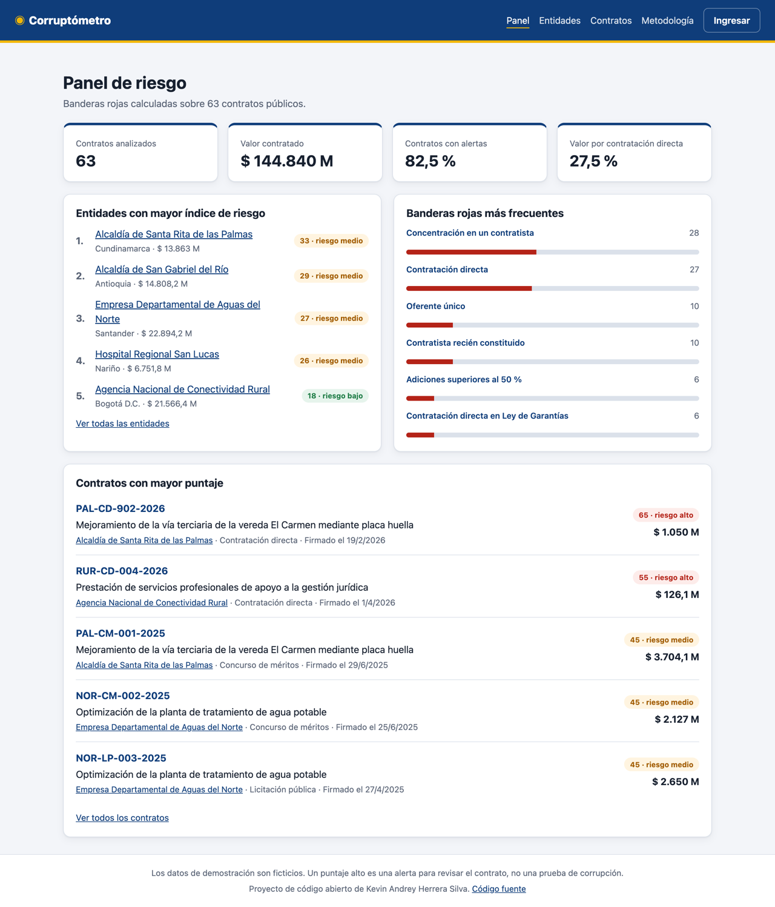
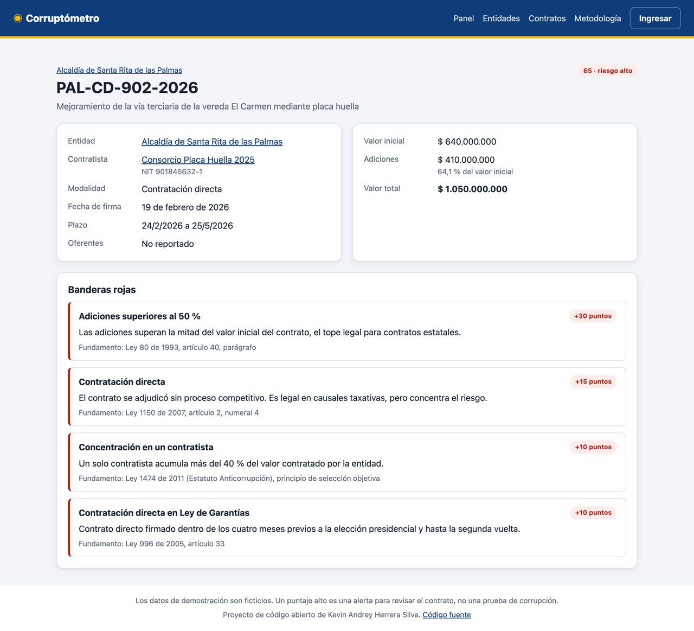

# Corruptómetro: índice de riesgo de corrupción en la contratación pública (Ruby on Rails 8)

[](https://github.com/KevinAndrey96/rails-corruptometro-public-procurement-risk-index/actions/workflows/ci.yml)


[](LICENSE)

**Corruptómetro** es una aplicación de **transparencia y control ciudadano** que calcula **banderas rojas** e **índices de riesgo de corrupción** sobre contratos públicos colombianos con datos en formato **SECOP II**. Cada alerta explica su **fundamento legal** (Ley 80 de 1993, Ley 1150 de 2007, Ley 1474 de 2011, Ley 996 de 2005) y cada entidad recibe un índice ponderado por el valor de lo que contrata.

Incluye panel público, ranking de entidades, buscador de contratos, API JSON abierta y un área administrativa autenticada para importar contratos desde CSV.



> Los datos de demostración son **ficticios**. Un puntaje alto es una alerta para revisar un contrato, no una prueba de corrupción.

## Características

- **Motor de banderas rojas** con seis indicadores de riesgo y pesos que suman 100.
- **Índice de riesgo por entidad**, promedio de los puntajes ponderado por valor contratado.
- **Panel público** con indicadores clave, banderas más frecuentes y rankings.
- **Ficha de contrato** con cada bandera, su peso y su fundamento normativo.
- **Buscador** por referencia u objeto, con filtros por bandera, modalidad y departamento.
- **Importador CSV** con la nomenclatura de datos abiertos de SECOP II: upsert idempotente, filas atómicas, errores por línea, soporte UTF-8 con BOM y Latin-1.
- **Validación del NIT** con el dígito de verificación de la DIAN.
- **API JSON** pública, paginada y con límite de solicitudes.
- **Protección de datos personales** (Ley 1581 de 2012): las cédulas de personas naturales se enmascaran y nunca salen por la API.

## Banderas rojas

| Bandera | Peso | Regla | Fundamento |
| --- | ---: | --- | --- |
| Adiciones superiores al 50 % | 30 | Adiciones mayores a la mitad del valor inicial | Ley 80 de 1993, art. 40, parágrafo |
| Oferente único | 20 | Proceso competitivo con un solo proponente | Ley 1150 de 2007, art. 2 |
| Contratación directa | 15 | Adjudicación sin proceso competitivo | Ley 1150 de 2007, art. 2, num. 4 |
| Contratista recién constituido | 15 | Empresa con menos de 365 días al firmar | Decreto 1082 de 2015 |
| Concentración en un contratista | 10 | Un contratista con más del 40 % del valor, en entidades con 5 o más contratos | Ley 1474 de 2011 |
| Contratación directa en Ley de Garantías | 10 | Contrato directo desde 4 meses antes de la elección presidencial hasta la segunda vuelta | Ley 996 de 2005, art. 33 |

Niveles de riesgo: **bajo** de 0 a 24, **medio** de 25 a 49 y **alto** de 50 a 100.



## Arquitectura

| Capa | Implementación |
| --- | --- |
| Dominio | `Entity`, `Contractor`, `Contract` con restricciones `CHECK` e índices únicos en SQLite |
| Reglas | `RedFlag` (catálogo), `RiskAssessor` (motor), `ElectoralCalendar`, `RiskLevel`, `NitValidator` |
| Casos de uso | `ContractImport` (CSV SECOP II), `ProcurementSummary` (indicadores) |
| Web | Controladores públicos, área `admin/` con sesión, `api/v1` sobre `ActionController::API` |
| Infraestructura | Rails 8.1, Solid Queue, Solid Cache, Solid Cable, Propshaft, importmap, Thruster |

Cada cambio en un contrato o en la fecha de constitución de un contratista recalcula las banderas de toda la entidad tras el commit. El importador desactiva ese recálculo por fila y reevalúa una vez por entidad al final.

## Inicio rápido con Docker

```bash
cp .env.example .env
# Completa SECRET_KEY_BASE (openssl rand -hex 64) y ADMIN_PASSWORD (mínimo 10 caracteres)
docker compose up --build
```

Abre <http://localhost:3000>. En el primer arranque se crea la base de datos, la cuenta administradora y se cargan los 63 contratos de demostración (`LOAD_DEMO_DATA=true`).

## Desarrollo local

Requisitos: Ruby 3.4 y SQLite 3.

```bash
bundle install
ADMIN_PASSWORD=una-clave-segura bin/setup
bin/dev
```

## Importar contratos

Desde el área administrativa (`/admin/import/new`) o por consola:

```bash
bin/rails corruptometro:import[db/samples/contratos_demo.csv]
bin/rails corruptometro:reassess
```

Columnas obligatorias: `nombre_entidad`, `nit_entidad`, `orden`, `departamento`, `referencia_del_contrato`, `objeto_del_contrato`, `modalidad_de_contratacion`, `fecha_de_firma`, `valor_del_contrato`, `proveedor_adjudicado`, `tipodocproveedor`, `documento_proveedor`.

Columnas opcionales: `fecha_de_inicio_del_contrato`, `fecha_de_fin_del_contrato`, `valor_adiciones`, `numero_de_oferentes`, `fecha_constitucion_proveedor`.

Fechas en `AAAA-MM-DD` o `DD/MM/AAAA`; valores en pesos con o sin separadores (`1234567`, `1.234.567`, `$ 1.234.567,00`). El archivo de ejemplo está en [`db/samples/contratos_demo.csv`](db/samples/contratos_demo.csv).

## API JSON

Sin autenticación, 120 solicitudes por minuto por IP, paginación con `page` y `per_page` (máximo 100).

```bash
curl http://localhost:3000/api/v1/entities?department=Antioquia
curl "http://localhost:3000/api/v1/contracts?flag=single_bidder&min_score=50&sort=recent"
curl http://localhost:3000/api/v1/red_flags
```

```json
{
  "data": [{ "reference": "PAL-CD-902-2026", "risk_score": 65, "risk_level": "high",
             "red_flags": ["additions_over_cap", "direct_award", "contractor_concentration", "electoral_restriction"] }],
  "meta": { "page": 1, "per_page": 25, "total_count": 1, "total_pages": 1 }
}
```

## Calidad y seguridad

```bash
bin/rails test          # 90 pruebas de modelos, importador, páginas públicas, admin y API
bin/rubocop             # estilo rubocop-rails-omakase
bin/brakeman            # análisis estático de seguridad
bin/bundler-audit       # dependencias con vulnerabilidades conocidas
bin/smoke-test URL      # prueba de humo contra un contenedor en ejecución
```

El pipeline de GitHub Actions ejecuta Brakeman, bundler-audit, auditoría de importmap, RuboCop, la suite de pruebas y construye la imagen de producción para correr la prueba de humo.

Medidas aplicadas: Content Security Policy estricta con nonces, `frame-ancestors 'none'`, HTTPS forzado por defecto, sesiones con cookies firmadas `httponly`, límite de intentos de inicio de sesión, sin registro público, sin credenciales en el repositorio y secretos solo por variables de entorno.

## Historia del proyecto

Corruptómetro nació en febrero de 2018 como proyecto universitario en Rails 5.1 con Devise, junto a José Nieto, Rubén Buelvas y @alejosaur. Ese código se conserva en la etiqueta [`v0.1-rails-5.1-devise-2018`](https://github.com/KevinAndrey96/rails-corruptometro-public-procurement-risk-index/tree/v0.1-rails-5.1-devise-2018). En 2026 se reescribió por completo sobre Rails 8.1 con el motor de riesgo, el importador SECOP II y la API.

## Licencia

[MIT](LICENSE) © 2018-2026 Kevin Andrey Herrera Silva
